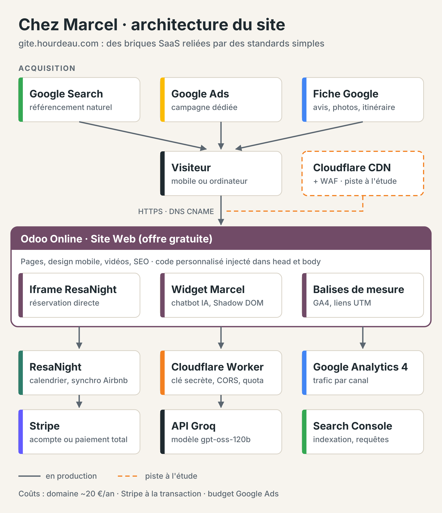
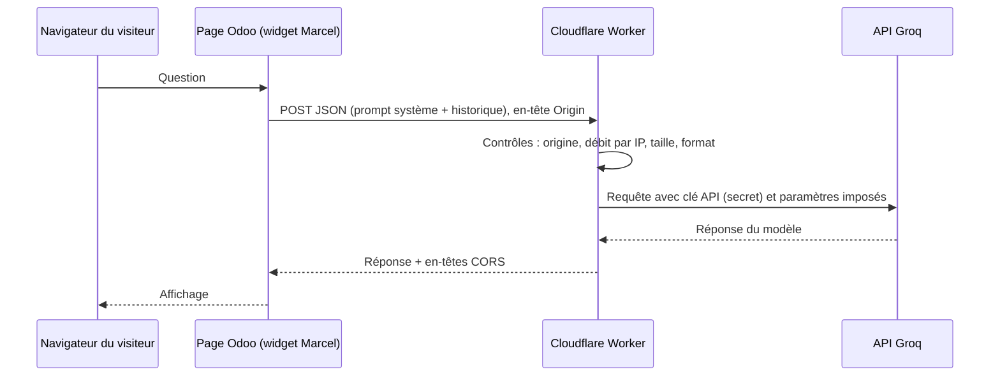

# Gîte Chez Marcel · gite.hourdeau.com

Documentation technique du site du gîte **Chez Marcel & son jardin** (Saint-Michel-Mont-Mercure, Sèvremont, Vendée), à 10 minutes du Puy du Fou.

Le site assemble des briques SaaS reliées par des points d'intégration standards : un enregistrement DNS, une iframe, un script injecté, une fonction serverless. Aucun serveur à administrer, aucune application développée sur mesure en dehors du widget de chat et de son proxy.

Ce document sert à deux choses : permettre à un développeur de reconstruire la configuration à l'identique, et servir de référence interne pour les évolutions.

> Les points marqués **⚠ À vérifier** n'ont pas été confirmés au moment de la rédaction. Ne pas les considérer comme acquis.

---

## Sommaire

1. [Vue d'ensemble](#1-vue-densemble)
2. [Contenu du dépôt](#2-contenu-du-dépôt)
3. [Comptes et prérequis](#3-comptes-et-prérequis)
4. [DNS](#4-dns)
5. [Odoo Online](#5-odoo-online)
6. [Réservation directe : ResaNight + Stripe](#6-réservation-directe--resanight--stripe)
7. [Marcel, l'assistant IA](#7-marcel-lassistant-ia)
8. [Proxy Cloudflare Worker](#8-proxy-cloudflare-worker)
9. [Acquisition et mesure](#9-acquisition-et-mesure)
10. [Sécurité](#10-sécurité)
11. [Procédures d'exploitation](#11-procédures-dexploitation)
12. [Limites connues et points ouverts](#12-limites-connues-et-points-ouverts)
13. [Feuille de route](#13-feuille-de-route)
14. [Coûts](#14-coûts)

---

## 1. Vue d'ensemble



| Brique | Rôle | Offre | Point d'intégration |
|---|---|---|---|
| LWS | Registrar et DNS de `hourdeau.com` | Nom de domaine | Enregistrement CNAME |
| Odoo Online | CMS : pages, contenus, SEO, multilingue | Gratuite « One App » (application Site Web) | Domaine personnalisé + injection de code |
| ResaNight | Disponibilités, réservation, synchronisation des calendriers, taxe de séjour | Forfait Solo gratuit (1 hébergement) | iframe |
| Stripe | Encaissement des paiements carte | Sans abonnement, commission par transaction | Compte connecté dans ResaNight |
| Marcel | Assistant conversationnel FR/EN | Code maison (`widget/`) | Script injecté en fin de `<body>` |
| Cloudflare Workers | Proxy sécurisé entre Marcel et l'API Groq | Workers Free | Appel HTTPS depuis le widget |
| Groq | Inférence du modèle `openai/gpt-oss-120b` | Offre gratuite | Appel HTTPS depuis le Worker |
| Google Search Console | Indexation, requêtes, couverture | Gratuit | Validation de propriété |
| Google Analytics 4 | Trafic, sources, canaux | Gratuit | Champ natif Odoo |
| Fiche d'établissement Google, Google Ads, ESPRIT | Acquisition | Gratuit / budget Ads | Liens tagués UTM |

Principe directeur : chaque brique est remplaçable sans reconstruire les autres.

---

## 2. Contenu du dépôt

```
.
├── README.md                  Ce document
├── docs/
│   └── architecture.png       Schéma d'architecture
├── widget/
│   └── marcel-widget.html     Bloc <script> à coller dans Odoo (configuration + profil + interface)
├── worker/
│   ├── wrangler.toml          Configuration du Worker (nom, limitation de débit, logs)
│   └── src/
│       └── index.js           Code source du proxy
└── .gitignore
```

> **Dépôt public.** Tout ce qui est versionné ici est lisible par n'importe qui. Aucun secret ne doit y figurer (voir [section 10](#10-sécurité)).

`worker/src/index.js` est le **code source**. Ne pas versionner le bundle généré par Wrangler (`.wrangler/`, `dist/`), déjà exclu par `.gitignore`.

---

## 3. Comptes et prérequis

| Compte | Usage | Remarque |
|---|---|---|
| LWS | DNS de `hourdeau.com` | Accès à la zone DNS |
| Odoo Online | Site | Base `gite-hourdeau` |
| ResaNight | Moteur de réservation | Forfait Solo |
| Stripe | Paiements | Connecté depuis ResaNight |
| Cloudflare | Worker | Compte personnel, distinct de tout compte professionnel. Double authentification activée |
| Groq | Clé API | Clé dédiée `marcel-proxy`, stockée uniquement dans Cloudflare |
| Google | Search Console, GA4, fiche d'établissement, Ads | |

Poste de travail pour le Worker : Node.js LTS et `npx wrangler` (aucune installation globale nécessaire).

Sur macOS, si l'installation de Node via `nvm` échoue, installer d'abord les outils en ligne de commande (`xcode-select --install`, puis attendre la fin de l'installation graphique), ou utiliser directement le paquet `.pkg` LTS de nodejs.org.

---

## 4. DNS

Zone `hourdeau.com` gérée chez LWS.

| Nom | Type | Cible |
|---|---|---|
| `gite` | CNAME | `gite-hourdeau.odoo.com.` |

Le certificat TLS de `gite.hourdeau.com` est délivré et renouvelé par Odoo Online. Rien à gérer côté LWS.

Vérification :

```bash
dig CNAME gite.hourdeau.com +short
# attendu : gite-hourdeau.odoo.com.
```

---

## 5. Odoo Online

### 5.1 Offre

Offre gratuite Odoo Online : **une seule application**, utilisateurs illimités, hébergement et maintenance inclus. Application installée : **Site Web**.

> Ne pas installer de deuxième application : selon les conditions d'Odoo, la base sort alors de l'offre gratuite. ⚠ À vérifier dans les conditions en vigueur avant toute installation.

### 5.2 Domaine personnalisé

Dans les paramètres du site Web, domaine déclaré : `https://gite.hourdeau.com`. L'adresse technique `https://gite-hourdeau.odoo.com` reste accessible. Elle figure donc dans la liste des origines autorisées du Worker.

### 5.3 Multilingue

| Langue | Code Odoo | Préfixe d'URL | Chatbot |
|---|---|---|---|
| Français | `fr_FR` | (aucun) | Oui |
| Anglais | `en_GB` | `/en/` | Oui |
| Espagnol | `es_ES` | `/es/` | Interface en français, réponse dans la langue du visiteur |
| Italien | `it_IT` | `/it/` | Interface en français, réponse dans la langue du visiteur |

⚠ À vérifier : les codes de langue exacts (`en_GB` ou `en_US`, etc.) dans Paramètres > Langues.

Méthode de traduction : outil de traduction automatique d'Odoo, puis **relecture humaine** de chaque page. Toute modification d'un contenu français doit être reportée dans les trois autres langues : Odoo ne propage pas les modifications aux traductions existantes.

### 5.4 Injection de code

Odoo permet d'injecter du code personnalisé dans le `<head>` et en fin de `<body>` de toutes les pages. ⚠ À vérifier : le chemin exact du menu selon la version d'Odoo (éditeur de site, onglet Thème, section avancée).

| Emplacement | Contenu |
|---|---|
| Fin de `<body>` | Contenu intégral de `widget/marcel-widget.html` |
| `<head>` | Rien pour GA4 (voir [9.2](#92-google-analytics-4)) |

### 5.5 Référencement

Outils natifs Odoo, page par page : titre, méta-description, URL, balises de langue alternatives (`hreflang`) générées par Odoo pour les quatre langues.

---

## 6. Réservation directe : ResaNight + Stripe

### 6.1 ResaNight

[ResaNight](https://www.resanight.com) est une solution française de gestion de gîtes. Forfait **Solo** gratuit : un hébergement, sans fonctions avancées.

| Élément | Paramétrage |
|---|---|
| Intégration | iframe fournie par ResaNight, collée dans un bloc HTML de la page Disponibilités d'Odoo |
| Sélection du logement | Choix préalable du logement dans le widget (utile si le compte en gère plusieurs) |
| Synchronisation | Bidirectionnelle avec les calendriers des plateformes, dont Airbnb (annonce maintenue) |
| Taxe de séjour | 5 % proportionnelle + 10 % de taxe additionnelle départementale, calculée par ResaNight |

⚠ À vérifier et documenter : le mécanisme de synchronisation (flux iCal ou API) et sa fréquence de rafraîchissement. Une synchronisation par iCal a un délai : une double réservation reste théoriquement possible dans cet intervalle.

La règle de taxe de séjour a été implémentée par l'éditeur à la demande, à partir du simulateur officiel : https://paysdepouzauges.taxesejour.fr/#simulateur. En cas de changement de délibération, vérifier le calcul sur une réservation test.

### 6.2 Stripe

| Élément | Paramétrage |
|---|---|
| Compte | Compte Stripe du propriétaire, connecté depuis ResaNight |
| Modes | Acompte ou paiement total |
| Tarification | 1,5 % du montant + 0,25 € par paiement carte |
| Recette | Testé de bout en bout avec une réservation réelle |

Aucune donnée de carte ne transite par le site Odoo : le paiement se fait dans l'iframe ResaNight, via Stripe.

---

## 7. Marcel, l'assistant IA

### 7.1 Flux



### 7.2 Structure du fichier `widget/marcel-widget.html`

Un seul bloc `<script>` autonome, en six parties :

| Partie | Contenu | Fréquence de modification |
|---|---|---|
| 1. `CONFIG` | Endpoint, limites, apparence, comportement | Rare |
| 2. `PROFIL` | Toutes les informations du gîte, consignes de l'IA, suggestions | Régulière |
| 3. `TEXTES_LANGUES` | Libellés de l'interface FR/EN | Rare |
| 4. Prompt | Construction automatique du prompt système à partir du profil | Jamais |
| 5. Interface | HTML/CSS dans un Shadow DOM | Rare |
| 6. Logique | Envoi, historique, erreurs, persistance | Rare |

### 7.3 Paramètres de `CONFIG`

| Clé | Valeur | Rôle |
|---|---|---|
| `GROQ_API_KEY` | `""` | **Doit rester vide.** Si renseignée, la clé serait publique |
| `ENDPOINT` | `https://marcel-proxy.hourdeau.workers.dev` | URL du Worker |
| `MODEL`, `TEMPERATURE`, `MAX_TOKENS`, `REASONING_EFFORT` | `openai/gpt-oss-120b`, `0.4`, `1500`, `low` | **Ignorés en production** : le Worker impose ses propres valeurs. Conservés pour cohérence |
| `HISTORY_LIMIT` | `12` | Messages d'historique envoyés. Ne pas dépasser 13 (le Worker refuse plus de 14 messages, prompt système compris) |
| `TIMEOUT_MS` | `30000` | Délai maximal d'attente côté navigateur |
| `MAX_CARACTERES` | `500` | Longueur maximale d'une question |
| `MAX_MESSAGES_SESSION` | `30` | Questions par onglet. Dissuasif seulement : contournable en vidant le `sessionStorage` |
| `PERSISTANCE` | `true` | Conversation conservée de page en page (`sessionStorage`, effacée à la fermeture de l'onglet) |
| `PAGES_EXCLUES` | `["/web", "/odoo"]` | Widget masqué dans le back-office |
| `MASQUER_DANS_IFRAME` | `false` | Laisser à `false` : connecté à Odoo, le site s'affiche en iframe |
| `LIEN_CONTACT` | Lien court de l'annonce Airbnb | Pied du chat |
| `SUIVI` | `null` | Point d'accroche pour envoyer les événements du widget à GA4 (exemple commenté dans le fichier) |

Le widget est aussi masqué en mode édition Odoo (classe `editor_enable` sur `<body>`) et se remplace lui-même s'il est injecté deux fois.

### 7.4 Langue

La langue est déduite de l'attribut `<html lang>` renseigné par Odoo, avec repli sur le préfixe d'URL `/en/`.

| Langue de la page | Interface du widget | Consigne envoyée au modèle |
|---|---|---|
| Anglais (`en*`) | Anglais | Répondre en anglais britannique, traduire fidèlement le profil, conserver les noms propres |
| Toute autre langue | Français | Langue par défaut français, mais répondre dans la langue du voyageur |

Le profil est **unique**, rédigé en français. Seuls `sousTitre`, `messageAccueil` et `suggestions` sont fournis en FR et EN.

Conséquence pour l'espagnol et l'italien : l'interface reste en français, mais le modèle répond dans la langue dans laquelle le visiteur écrit.

### 7.5 Profil et prompt

Le profil (`PROFIL`) est un objet structuré : `gite`, `reservation`, `arrivee`, `depart`, `pratique`, `securite`, `regles`, `alentours`, `hote`, `faq`, `consignes`. La fonction `construirePrompt()` l'aplatit en texte. Ajouter une clé dans une section suffit : elle apparaît automatiquement dans le prompt. Une valeur vide (`""`) est ignorée.

Taille actuelle du prompt système : environ 10 500 caractères. Avec 12 messages d'historique, la requête reste nettement sous la limite de 60 000 caractères du Worker.

### 7.6 Garde-fous

Définis dans `PROFIL.consignes` :

- ne jamais inventer : sans information dans le profil, renvoyer vers l'hôte ;
- ne jamais confirmer une réservation, un prix définitif ou une disponibilité ;
- ne jamais donner d'horaires, de tarifs ou de règles absents du profil ;
- ne jamais communiquer de code d'accès, de mot de passe ou de donnée personnelle ;
- en cas d'urgence, donner d'abord les numéros de secours ;
- 3 phrases maximum sauf besoin de détail ;
- répondre honnêtement qu'il est un assistant IA si on le demande ;
- refuser les sujets sans rapport avec le séjour, le gîte ou la région.

Ces consignes réduisent les risques, elles ne les suppriment pas. Un modèle de langage peut se tromper. La mention « Marcel est un assistant IA, il peut se tromper » est affichée en permanence.

**Règle absolue : le profil ne contient aucune donnée que le modèle ne doit pas divulguer.** Le code de la boîte à clé, le mot de passe Wi-Fi ou un téléphone personnel n'ont rien à y faire. Une consigne « ne pas divulguer » n'est pas une protection : le prompt est de toute façon lisible dans le code source de la page.

### 7.7 Sécurité de l'affichage

- Les messages du visiteur sont insérés en `textContent` (aucune interprétation HTML).
- Les réponses du modèle sont rendues par `rendre()` : seuls les liens `http(s)` et le gras `**…**` sont convertis, en nœuds DOM créés un par un. Pas d'`innerHTML` sur du contenu généré.
- Les liens s'ouvrent avec `rel="noopener noreferrer"`.
- Le Shadow DOM isole le CSS du widget de celui du thème Odoo.

---

## 8. Proxy Cloudflare Worker

### 8.1 Rôle

Le navigateur ne contacte jamais Groq directement. Le Worker `marcel-proxy` :

| Contrôle | Implémentation | Réponse en cas d'échec |
|---|---|---|
| Origine | En-tête `Origin` comparé à la liste `ORIGINES` | `403` |
| Méthode | `POST` uniquement (`OPTIONS` pour la requête préalable CORS) | `405` |
| Débit | Binding `LIMITEUR` : 10 requêtes / 60 s / IP (`CF-Connecting-IP`) | `429` |
| Taille | 60 000 caractères maximum | `413` |
| Format | JSON valide, 1 à 14 messages, rôles `system`/`user`/`assistant`, contenu texte | `400` |
| Paramètres | Modèle, température, `max_tokens`, `reasoning_effort` imposés côté serveur | |
| Secret | Clé Groq lue dans `env.GROQ_API_KEY` | |

Les erreurs sont renvoyées au format `{ "error": { "message": "…" } }`, compatible avec le traitement d'erreurs du widget (le code `429` affiche un message dédié).

### 8.2 Déploiement

Depuis le dossier `worker/` :

```bash
npx wrangler login                       # autorisation OAuth dans le navigateur
npx wrangler secret put GROQ_API_KEY     # coller la clé Groq, stockée chiffrée chez Cloudflare
npx wrangler deploy                      # publie sur https://marcel-proxy.hourdeau.workers.dev
```

La limitation de débit se déclare dans `wrangler.toml` (`[[ratelimits]]`) : elle n'est pas configurable depuis le tableau de bord Cloudflare. D'où le déploiement en ligne de commande.

Si Wrangler refuse la `compatibility_date`, utiliser la date qu'il propose.

### 8.3 Recette

```bash
# 1. Appel hors du site : doit être refusé (403, "Origine non autorisée")
curl -X POST https://marcel-proxy.hourdeau.workers.dev \
  -H "Content-Type: application/json" -d '{}'

# 2. Journaux en temps réel pendant un test depuis le site
npx wrangler tail
```

3. Sur le site, en navigation privée : poser une question, puis vérifier dans l'onglet Réseau des outils de développement que la requête part vers `workers.dev` et ne contient aucune clé.

### 8.4 Limites d'usage

Workers Free : 100 000 requêtes par jour et 10 ms de CPU par invocation. Le temps d'attente de la réponse Groq ne compte pas comme du CPU.

---

## 9. Acquisition et mesure

### 9.1 Google Search Console

⚠ À vérifier : type de propriété et méthode de validation. Pour le savoir :

1. Search Console > sélecteur de propriété : une propriété **Domaine** s'affiche sous la forme `hourdeau.com`, une propriété **Préfixe d'URL** sous la forme `https://gite.hourdeau.com/`.
2. Paramètres > Utilisateurs et autorisations > propriétaire > détails de la validation : la méthode utilisée y figure.
3. Contrôles techniques :

```bash
dig TXT hourdeau.com +short | grep google-site-verification      # validation DNS
curl -s https://gite.hourdeau.com | grep -i google-site-verification   # validation par balise HTML
```

Recommandation : propriété **Domaine** validée par enregistrement TXT chez LWS. Elle couvre tous les sous-domaines et ne dépend pas d'une balise qu'une modification du site Odoo pourrait supprimer.

Sitemap à déclarer : `https://gite.hourdeau.com/sitemap.xml` (généré par Odoo).

### 9.2 Google Analytics 4

Installation retenue : **champ natif d'Odoo** (ID de mesure `G-…` dans les paramètres du site Web).

> **Ne pas ajouter en parallèle le code `gtag.js` en injection personnalisée.** Les deux installations chargent la balise deux fois et doublent les pages vues. Si un code personnalisé GA4 est présent dans le `<head>`, le supprimer.

Vérification : GA4 > Rapports > Temps réel, ouvrir une page : un seul `page_view` doit remonter. L'extension Tag Assistant de Google montre aussi le nombre de balises chargées.

⚠ À vérifier : consentement aux cookies (RGPD). GA4 dépose des cookies de mesure qui nécessitent le consentement préalable du visiteur. Vérifier que la bannière de cookies d'Odoo est activée et que la balise GA4 native ne se déclenche qu'après acceptation.

Optionnel : brancher les événements du widget sur GA4 via `CONFIG.SUIVI` (exemple fourni en commentaire dans le fichier). Événements disponibles : `ouverture`, `message`, `effacement`, `erreur`, `teaser`.

### 9.3 Canaux d'acquisition

| Canal | Rôle |
|---|---|
| Référencement naturel | Canal durable, suivi dans Search Console |
| Fiche d'établissement Google | Google Maps et résultats locaux, lien tagué UTM vers le site |
| Google Ads | Campagne dédiée au gîte, budget piloté |
| ESPRIT | Réseau d'information touristique des Pays de la Loire |
| Réseaux sociaux, signature e-mail, YouTube, LinkedIn | Liens tagués UTM |

### 9.4 Convention UTM

Format : `https://gite.hourdeau.com/?utm_source=<source>&utm_medium=<support>&utm_campaign=<campagne>`

| Lien | `utm_source` | `utm_medium` | `utm_campaign` |
|---|---|---|---|
| Article LinkedIn | `linkedin` | `article` | `lancement_site` |
| Post LinkedIn | `linkedin` | `post` | `lancement_site` |

⚠ À compléter avec les tags réellement utilisés pour la fiche Google, ESPRIT, YouTube, la signature e-mail et les réseaux sociaux. Règles : minuscules, pas d'espaces, une valeur stable par canal. Inutile de taguer les liens Google Ads si l'auto-tagging (`gclid`) est actif et le compte Ads lié à GA4.

---

## 10. Sécurité

### 10.1 Modèle de menaces

| Menace | Mesure en place | Risque résiduel |
|---|---|---|
| Vol de la clé API Groq | Clé uniquement dans un secret Cloudflare. Ancienne clé exposée révoquée | Faible |
| Usage du proxy depuis un autre site web | Contrôle `Origin` + CORS | Faible pour les navigateurs |
| Usage du proxy par script (curl, Python) | Limitation de débit par IP | **Moyen** : l'en-tête `Origin` se falsifie hors navigateur |
| Détournement du proxy en LLM généraliste | Paramètres imposés, taille plafonnée | **Moyen** : le prompt système vient du navigateur (voir [13](#13-feuille-de-route)) |
| Rafales de requêtes | 10 req/min/IP | Compteur local à chaque point de présence Cloudflare : filtre, pas barrière |
| Injection HTML via les réponses du modèle | Rendu DOM sans `innerHTML`, liens `noopener` | Faible |
| Divulgation d'informations sensibles par le modèle | Aucune donnée sensible dans le profil | Faible |
| Données de paiement | Traitées par ResaNight et Stripe, jamais par Odoo | Faible |
| Fuite de secret via le dépôt public | `.gitignore`, revue avant commit, protection GitHub | Faible si la procédure est suivie |

### 10.2 Règles du dépôt public

- Aucune clé, aucun token, aucun mot de passe dans un fichier versionné. `GROQ_API_KEY` reste `""` dans le widget.
- Activer dans GitHub : Settings > Code security > **Secret scanning** et **Push protection**.
- Avant chaque commit touchant le widget :

```bash
git diff --cached | grep -E "gsk_|sk_live|sk_test" && echo "SECRET DÉTECTÉ, NE PAS COMMITER"
```

- Vérifier l'historique une fois, à la création du dépôt :

```bash
git log -p --all | grep -E "gsk_[A-Za-z0-9]{10,}"
```

Une clé retrouvée dans l'historique doit être considérée comme compromise et révoquée, même si elle a été supprimée depuis.

- Le profil du gîte est public de fait (il est dans le code source de chaque page). Le dépôt n'ajoute pas d'exposition, à condition de respecter la règle de la [section 7.6](#76-garde-fous).

### 10.3 Rotation de la clé Groq

1. console.groq.com > API Keys > créer une nouvelle clé.
2. `npx wrangler secret put GROQ_API_KEY` (remplace la valeur).
3. Tester une question sur le site.
4. Révoquer l'ancienne clé dans la console Groq.

Aucun redéploiement du code n'est nécessaire.

---

## 11. Procédures d'exploitation

| Besoin | Procédure |
|---|---|
| Mettre à jour une information du gîte | Modifier `PROFIL` dans `widget/marcel-widget.html`, coller le fichier complet dans l'injection de code Odoo, tester, commiter |
| Ajouter une suggestion | `PROFIL.suggestions.fr` et `.en` |
| Ajouter une langue d'interface au chat (ES, IT) | Ajouter la langue dans `TEXTES_LANGUES`, `sousTitre`, `messageAccueil`, `suggestions`, adapter la détection `LANG` et `regleLangue()` |
| Changer de modèle | Modifier `MODELE` dans `worker/src/index.js`, puis `npx wrangler deploy`. La valeur côté widget est sans effet |
| Ajouter un domaine autorisé | Ajouter l'origine exacte (schéma + hôte, sans `/` final) dans `ORIGINES`, redéployer |
| Ajuster la limite de débit | `limit` / `period` dans `wrangler.toml`, redéployer |
| Augmenter `HISTORY_LIMIT` | Augmenter aussi `MAX_MESSAGES` dans le Worker (historique + 1) |
| Diagnostiquer une erreur du chat | Console du navigateur (le widget y écrit le code HTTP et le message), puis `npx wrangler tail` |
| Faire tourner la clé Groq | [Section 10.3](#103-rotation-de-la-clé-groq) |
| Modifier un contenu du site | Éditeur Odoo, puis reporter dans EN, ES, IT et faire relire |

Toute modification du widget ou du Worker est commitée dans ce dépôt **après** test en production. Le dépôt est la référence.

---

## 12. Limites connues et points ouverts

**Limites assumées**

- Le prompt système est construit dans le navigateur et lisible par tous.
- Le contrôle d'origine ne bloque pas un client hors navigateur.
- La limite de débit est locale à chaque point de présence Cloudflare.
- L'interface du chat n'existe qu'en français et en anglais.
- Les offres gratuites (Odoo, ResaNight, Groq, Cloudflare) peuvent évoluer. Chaque brique doit rester remplaçable.

**⚠ À vérifier**

- [ ] Méthode de validation Search Console ([9.1](#91-google-search-console))
- [ ] Suppression du doublon GA4 en code personnalisé ([9.2](#92-google-analytics-4))
- [ ] Consentement cookies et déclenchement de GA4 ([9.2](#92-google-analytics-4))
- [ ] Mécanisme et fréquence de synchronisation ResaNight / Airbnb ([6.1](#61-resanight))
- [ ] Codes de langue Odoo ([5.3](#53-multilingue))
- [ ] Chemin du menu d'injection de code selon la version d'Odoo ([5.4](#54-injection-de-code))
- [ ] Conditions de l'offre gratuite Odoo en cas d'ajout d'application ([5.1](#51-offre))
- [ ] Tags UTM existants à recenser ([9.4](#94-convention-utm))

---

## 13. Feuille de route

1. **Prompt côté serveur.** Déplacer `PROFIL` et `construirePrompt()` dans le Worker. Le navigateur n'enverrait plus que l'historique et la langue. Un détournement du proxy ne produirait que des réponses sur le gîte. Contrepartie : mise à jour du profil par `wrangler deploy` au lieu d'Odoo.
2. **Mesure du chat.** Brancher `CONFIG.SUIVI` sur GA4.
3. **Cloudflare en frontal.** Déléguer la zone `hourdeau.com` à Cloudflare (offre gratuite : CDN, protection DDoS, pare-feu applicatif). ⚠ Compatibilité à valider : sur Odoo Online, c'est Odoo qui gère le domaine personnalisé et le certificat. Configuration déjà éprouvée par ailleurs devant une instance Odoo 19 Community auto-hébergée, mais le contexte n'est pas transposable tel quel. Impact sur l'ensemble des enregistrements de la zone à évaluer.
4. **Chat en espagnol et italien.**
5. **Réplication** de l'architecture pour un autre site associatif sur Odoo.

---

## 14. Coûts

| Poste | Coût |
|---|---|
| Odoo Online, offre gratuite | 0 € |
| ResaNight, forfait Solo | 0 € |
| Groq, offre gratuite | 0 € |
| Cloudflare Workers Free | 0 € |
| Nom de domaine (LWS) | environ 20 € par an |
| Stripe | 1,5 % + 0,25 € par paiement carte encaissé |
| Google Ads | Budget piloté |

---

*Site : https://gite.hourdeau.com · Contact : gite@hourdeau.com*
